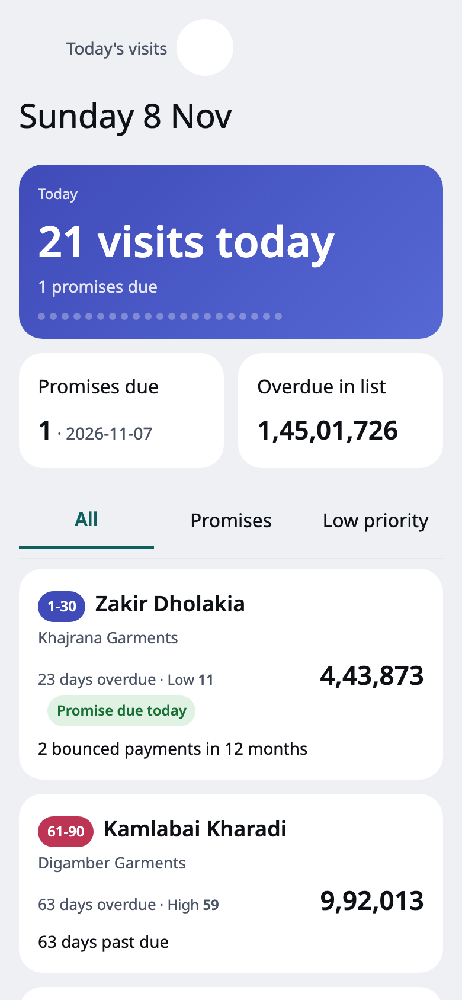
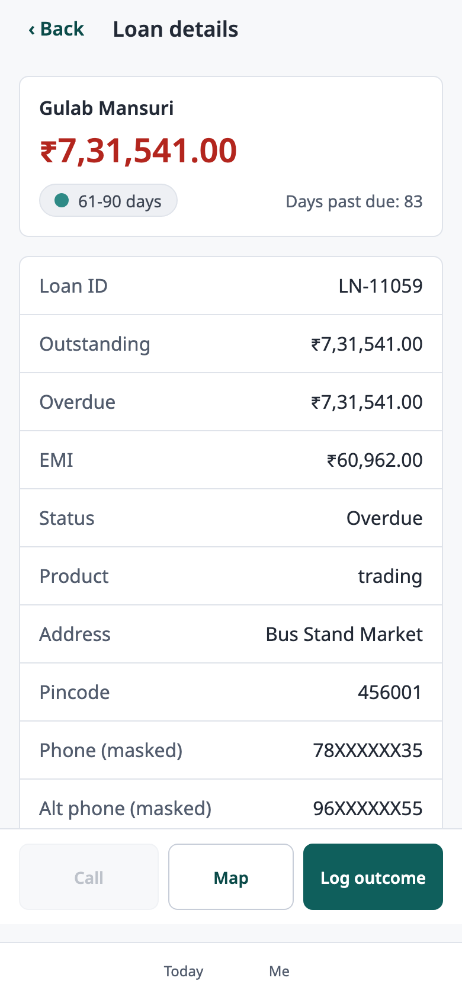
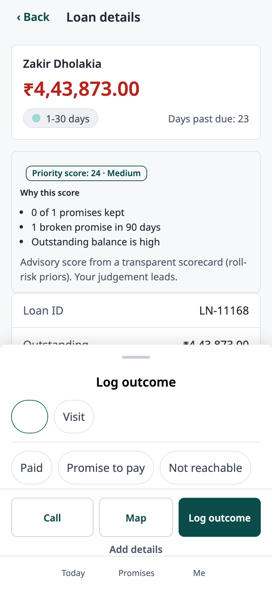
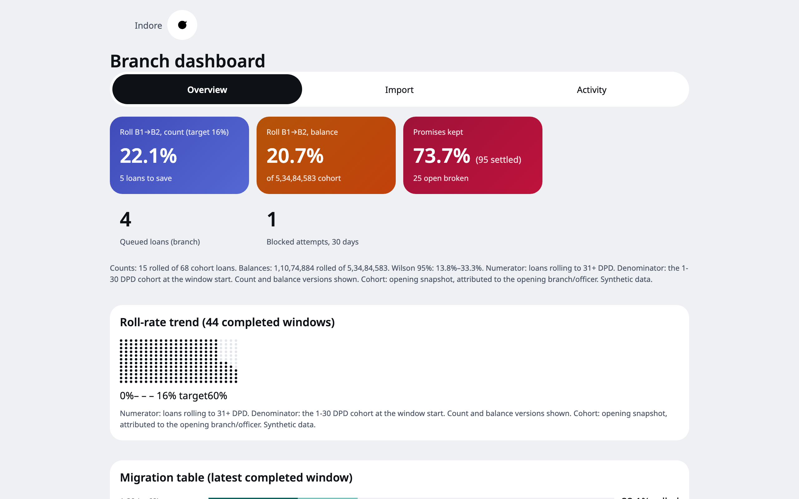

# Field Collections

A mobile workspace for field collections teams at an Indian MSME lender.

Field Collections replaces spreadsheet based allocation, WhatsApp updates and handwritten promise tracking with a prioritised officer worklist, reliable offline event capture and a branch manager view of roll rates.

**[Open the live demo](https://isocode-swe-assignment.vercel.app)**  
**[View the source repository](https://github.com/manavmax/isocode_SWE_assignment)**  
**[View the latest CI run](https://github.com/manavmax/isocode_SWE_assignment/actions/runs/42593911874)**

The live environment is a demonstration using synthetic data only. It is not connected to a lender's production systems.

## Product experience

### Officer workspace

The officer starts with a short, prioritised worklist. Each loan shows its DPD bucket, overdue amount, priority band and the most useful reason for its position. The loan detail view explains the top three score contributions and keeps Call, Map and Log outcome actions within reach.





### Outcome capture

Officers can record a call or visit as paid, promise to pay, not reachable, dispute or another supported outcome. Promise details are validated before saving. GPS is captured when available, but a weak signal or unavailable location does not prevent the officer from recording the event.



### Manager workspace

Branch managers can import the daily overdue file, inspect assignment results and data quality exceptions, review count and balance based roll rates, monitor broken promises and inspect officer activity.



## Try the demonstration

All accounts use the demonstration PIN `1234`. The PIN is a public demo credential, not a production password. Demo accounts are accepted only when `DEMO_MODE` is enabled.

**`demo-officer-1` · Field officer, Indore**  
Review the prioritised list, inspect score reasons, log an outcome and explore the promise tracker.

**`demo-officer-2` · Field officer, Dewas**  
Compare a second officer's assigned worklist.

**`demo-officer-3` · New field officer**  
Review the empty state for an officer without an assigned territory.

**`demo-manager` · Branch manager, Indore**  
Review roll rates, broken promises, exceptions, imports, assignment outcomes and officer activity.

A useful demonstration sequence is:

1. Sign in as `demo-officer-1` and open the first loan in Today.
2. Read the score explanation, then use Log outcome to record a promise or visit result.
3. Open Promises and inspect the resulting promise state.
4. With the worklist already loaded, enable airplane mode and record another outcome. The item should remain in the local outbox.
5. Restore connectivity and open the Sync view to inspect the delivery result.
6. Sign in as `demo-manager` and inspect the dashboard, import history and activity log.

The seeded demonstration story is date sensitive. See [deployment instructions](docs/deployment.md) for the reseed procedure.

## What is implemented

**Daily overdue import**  
CSV decoding, header aliases, row validation, duplicate handling, downloadable error reports, snapshot comparison and defensive import aborts.

**Work allocation**  
Pincode and locality routing, branch boundaries, workload capacity, officer leave cover, reassignment hysteresis and an unmapped loan queue.

**Officer worklist**  
A server ordered priority list, loan detail, score reasons, masked phone numbers, Call and external map actions.

**Outcome logging**  
Call and visit outcomes, notes, promise details, GPS status, a short Undo period and local first persistence.

**Offline operation**  
Dexie and IndexedDB caches, a durable event outbox, single flight sync, idempotent event identifiers, retry backoff and visible failure states.

**Promise tracking**  
Due, upcoming, kept, broken and partly broken promise states with manager attention flags.

**Manager analytics**  
Thirty day cohort roll rates by count and balance, confidence intervals, migration views, officer summaries and exceptions.

**Access and audit**  
Field officer and branch manager roles, branch and officer scoped data access, audit events, masked contact details and security headers.

**Language**  
Hindi and English officer screens. Manager screens are currently English only.

## Explainable prioritisation

The priority engine is a transparent logistic scorecard. It is deliberately described as a scorecard rather than a trained machine learning model.

The score estimates the chance that a loan moves to a worse delinquency bucket within the next thirty days. Its inputs include days past due, payment bounce history, broken promises, promise keeping history, time since last contact, overdue amount relative to EMI, outstanding balance, loan vintage and the most recent contact outcome.

The model starts from the brief's 22 percent portfolio roll rate. Continuous features are standardised and clipped before their weighted contributions are added. The three largest positive contributions become the loan's displayed reasons. The worklist also considers promises due and rupees at risk. Managers can pin a loan when operational judgement should override the score.

**Model evaluation is intentionally conservative.** On the seeded synthetic cohort, the scorecard AUC is 0.613, with a 95 percent confidence interval from 0.504 to 0.720. That interval includes 0.5. The experiment therefore does not establish that the scorecard beats chance on this data, and synthetic performance is not evidence of real borrower prediction accuracy. The weights are expert assumptions, not coefficients fitted to real collection outcomes.

The score is advisory. Officers can work loans in a different order, managers can pin priorities, and the score and its feature evidence are retained for review. A real deployment should fit and validate the model using the lender's own historical cohorts before operational reliance.

## Offline reliability

An outcome is written to IndexedDB before any network request is attempted. Each event receives a client generated UUID. The server treats a repeated UUID as an idempotent retry, so a lost acknowledgement does not create a second contact record.

The sync engine sends the oldest pending events in small batches. Network errors, timeouts, rate limits and server errors are retried with exponential backoff. Validation failures remain visible for review. An expired session does not clear the outbox; the officer can sign in again and sync the retained events.

The application caches the shell and relevant officer data locally. Sync resumes when the application is opened, brought to the foreground, reconnected or manually requested. It does not depend on background sync being available.

## Contact controls and privacy

The application applies an 08:00 to 19:00 IST contact window. The phone experience blocks an out of window call and records a blocked attempt. The server independently evaluates the event time when it is synced. Compliance violations are retained as records rather than silently discarded.

Phone numbers are masked in ordinary API responses and local worklists. An assigned officer can request a number only through the server controlled reveal path, which applies the contact window, rate limit and audit record. Offline caches are cleared on logout and expire according to their documented retention rules.

These controls are engineering safeguards for the assignment. They are not a certification of regulatory compliance. The rule sets and borrower communication process require review by the lender's compliance and legal teams before real use.

## Business case from the brief

The assignment estimates the opportunity from reducing the monthly roll rate from 22 percent to 16 percent:

1. **450 loans** enter the 1 to 30 DPD bucket each month.
2. Reducing the roll rate from 22 percent to 16 percent means **27 fewer rollovers per month**, or **324 per year**.
3. Under the supplied assumptions, expected loss per rolled loan is **₹35,000**.
4. The illustrative annual credit loss opportunity is **₹1.134 crore**.
5. The estimated annual manual reporting time cost is **₹49.5 lakh**.
6. The total illustrative annual opportunity is **₹1.629 crore**.

These are scenario calculations supplied by the assignment brief. They are not measured savings, realised returns or a claim that this application has already reduced roll rates.

## Architecture

The application is a single React and TypeScript Progressive Web App. The client uses Dexie and IndexedDB for local state and the event outbox. A Hono API runs through a Vercel serverless function. Drizzle provides the data layer over Neon Postgres. Zod validates request payloads, and shared TypeScript modules hold the core rules so they can be tested without database or network access.

**Client:** Vite, React, TypeScript, Dexie, Workbox  
**API:** Hono, Zod, Node.js  
**Database:** Neon Postgres, Drizzle ORM  
**Quality:** Vitest, fake IndexedDB, Playwright based local audit scripts, GitHub Actions  
**Hosting:** Vercel and Neon

### Repository map

**`src/client`**  
Officer and manager screens, language dictionaries, PWA setup, local database and sync engine.

**`src/server`**  
Hono routes, authentication, data access, imports, assignment, scoring and scheduled jobs.

**`src/shared`**  
Import parsing, assignment rules, contact window logic, promise states, scorecard and roll rate calculations.

**`drizzle`**  
Database schema migrations.

**`scripts`**  
Seed generation, integration checks, backtest, design audit, layout audit, mobile checks and live smoke tests.

**`docs`**  
Assumptions, architecture decisions, entity model, security notes, backtest results, screenshots and engineering log.

**`data`**  
Synthetic import fixtures and seed configuration.

## Run locally

### Requirements

Node.js 22 and pnpm 12 are used by the project.

### Setup

```bash
git clone https://github.com/manavmax/isocode_SWE_assignment.git
cd isocode_SWE_assignment
pnpm install
cp .env.example .env
```

Add the required environment variables to `.env`. Supply your own database connection string and a strong session secret. Keep real credentials out of source control.

```text
DATABASE_URL
SESSION_SECRET
DEMO_MODE
```

`DATABASE_URL_UNPOOLED` is optional. `CRON_SECRET` is required only when enabling the nightly job. The environment variable names and their purposes are documented in [deployment.md](docs/deployment.md).

Apply the migrations:

```bash
pnpm db:migrate
```

For a fresh, dedicated demonstration database, build the seeded history through the real import pipeline:

```bash
pnpm seed -- --seed 20261105 --as-of 2026-11-07 --yes --reset
```

The seed takes approximately fifteen minutes. The reset option truncates demonstration tables, so use it only with a disposable assignment database.

Start the application:

```bash
pnpm dev
```

The Vite application runs on port `5173`; the local API runs on port `8787`.

## Verification

The latest inspected GitHub Actions run, run 32 on 9 November 2026, completed successfully with **626 tests across 62 test files**. The workflow also passed lint, typecheck, API checks and Gitleaks.

Run the main checks locally:

```bash
pnpm test
pnpm lint
pnpm typecheck
pnpm check:api
```

Additional browser and deployment checks are available:

```bash
node scripts/design-audit.mjs
node scripts/layout-audit.mjs
node scripts/mobile-check.mjs
node scripts/offline-sync-check.mjs
pnpm smoke:live https://isocode-swe-assignment.vercel.app
```

The browser audit scripts are local checks. The live smoke script exercises the deployed HTTP routes and security headers. See [deployment.md](docs/deployment.md) for the complete procedure.

## Known limitations

This is a focused engineering demonstration, not a production collections platform.

1. All borrower, loan, payment, promise and activity data is synthetic.
2. Payment outcomes are inferred from daily balance changes and loan disappearance in the full overdue snapshot. A production integration needs a reconciled payment feed from the lender's loan management system.
3. The sample brief does not contain pincode and branch fields. The demonstration adds territory data; the real CSV contract and territory mapping must be agreed with the lender.
4. The scorecard uses expert weights and synthetic data. It is not fitted or validated on real borrowers, and automated drift or bias monitoring is not implemented.
5. Real borrower reminders, AI drafted message content, the message word filter and real SMS or WhatsApp delivery are not implemented. The assignment treats these as optional depth beyond the core build.
6. Payments and messaging are mocked. The application does not collect cash, issue payment links or send real messages.
7. The Map action opens an external map destination. Route planning and route optimisation are not included.
8. The manager interface is English only. Hindi officer copy needs review by a native speaker.
9. The contact window is enforced conservatively. Support for a documented borrower request to be contacted outside the normal window is not wired into the current call flow.
10. Authentication uses a demonstration PIN flow. MFA, device binding and a penetration test are not included.
11. The offline flow has browser based test evidence. A physical low cost Android airplane mode test, iOS Safari pass, screen reader review and hardware back button pass remain outstanding.

## Before production use

A real rollout should be gated on the following work:

1. Confirm the lender's actual CSV schema, branch hierarchy, pincode mapping and loan management system identifiers.
2. Replace inferred payment changes with a reconciled payment event integration.
3. Have compliance and legal teams approve contact rules, borrower requested exceptions, visit policy, approved communication templates, grievance details and audit retention.
4. Have a native Hindi reviewer approve all officer facing language.
5. Fit and calibrate the scorecard on historical lender data, use time based validation, review outcomes by branch and borrower segment, and monitor drift.
6. Introduce the lender's production identity provider, stronger authentication, device controls, secret rotation and independent security testing.
7. Complete physical device testing on low cost Android phones, poor networks, iOS Safari and assistive technologies.
8. Add approved messaging providers, delivery receipts, opt out and contact preference handling before enabling borrower reminders.

## Project documentation

**[Technical design and architecture notes](SPEC.md)**  
Scope, workflows, architecture and detailed behavioural rules.

**[Assumptions register](docs/assumptions.md)**  
Explicit assumptions and decisions requiring confirmation.

**[Backtest report](docs/backtest.md)**  
Synthetic cohort definition, evaluation and limitations.

**[Security notes](docs/security.md)**  
Authentication, access control, privacy and audit design.

**[Entity relationship model](docs/er.md)**  
Database entities and relationships.

**[Deployment guide](docs/deployment.md)**  
Environment setup, migration, seed, deployment and smoke checks.

**[Engineering log](docs/log.md)**  
Decisions, bugs found, fixes and verification evidence.

## Project status

Built as a solo seven day take home assignment. The deployed application is intended for evaluation with synthetic data. No production lender data or external payment or messaging system is connected.

The repository does not currently declare an open source licence. All rights and reuse terms remain with the project author unless separately agreed.
