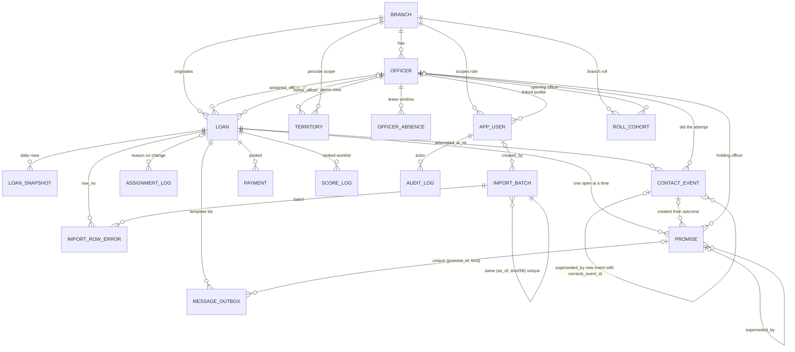

# ER diagram

Mermaid ER for the SPEC.md section 5 minimum data model. Money is stored in integer paise (`bigint`-backed, safe for Rs 25 lakh+ tickets: ~2.5e9 paise overflows `int32`). Instant timestamps are `timestamptz` (UTC); day-based fields (`as_of`, `promised_date`, cohort bounds) are `date` in IST-day terms, matching import contract "as of date".

Invariants recorded in migrations:
- `loan_snapshot` PK `(as_of, loan_id)` — one snapshot row per loan per day.
- `import_batch` UNIQUE `(as_of, file_sha256)` — same bytes on the same date is a no-op.
- `message_outbox` UNIQUE `(promise_id, kind)` — promiseless rows (`promise_id IS NULL`) are exempt by Postgres NULL semantics (intentional).
- `territory` UNIQUE NULLS NOT DISTINCT `(branch_id, pincode, locality, officer_id)` and `roll_cohort` UNIQUE NULLS NOT DISTINCT `(t0, t1, branch_id, officer_id)` — dedupe exact rows while still allowing one pincode-generic row per officer.
- `contact_event` is append-only by TRIGGER (`BEFORE UPDATE OR DELETE` raises; corrections supersede with `corrects_event_id`).
- `score_log` UNIQUE `(loan_id, as_of)` — one row per scoring run per day; immutability is a write-layer rule for Day 1 (trigger hardening is deferred to the TDD appendix).

Notes:
- Indore / Dewas / Ujjain are the three `branch` rows; the Ratlam officer and Ratlam loans belong to Ujjain (SPEC section 20, assumption A3).
- `bigint { mode: 'number' }` is used for paise so 25 lakh tickets (~2.5e9) do not overflow `int32`; all values stay far below 2^53.
